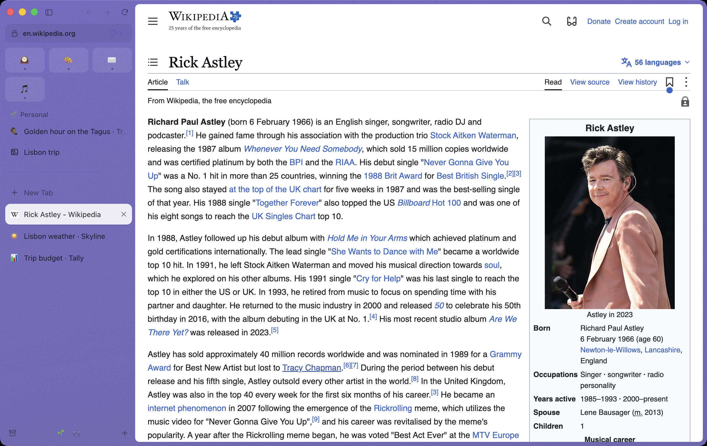
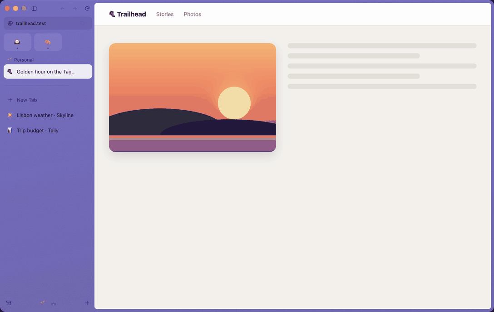
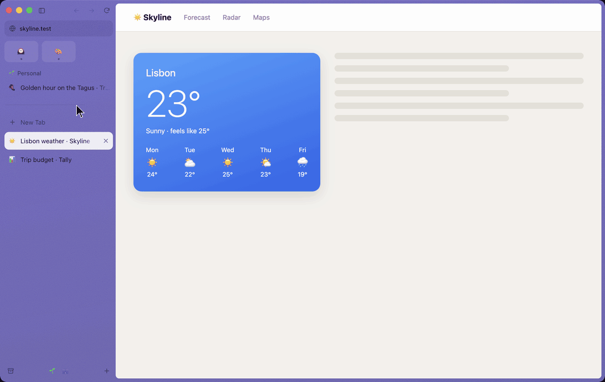
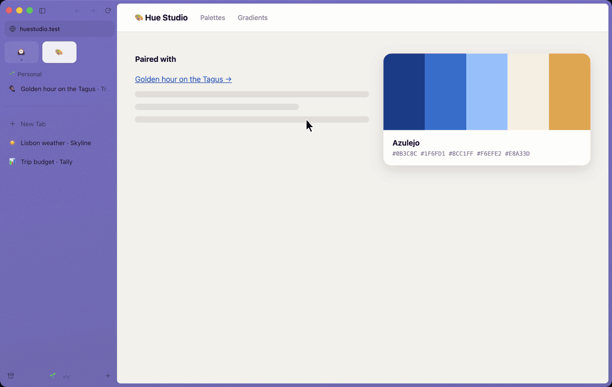
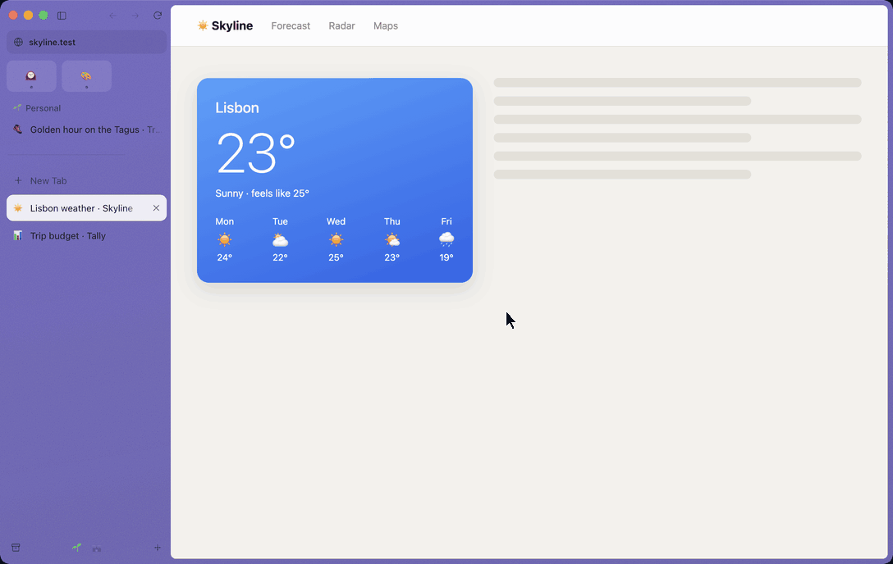
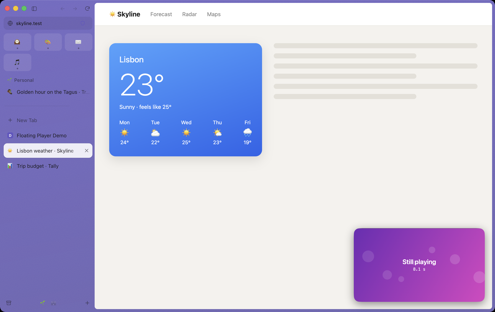
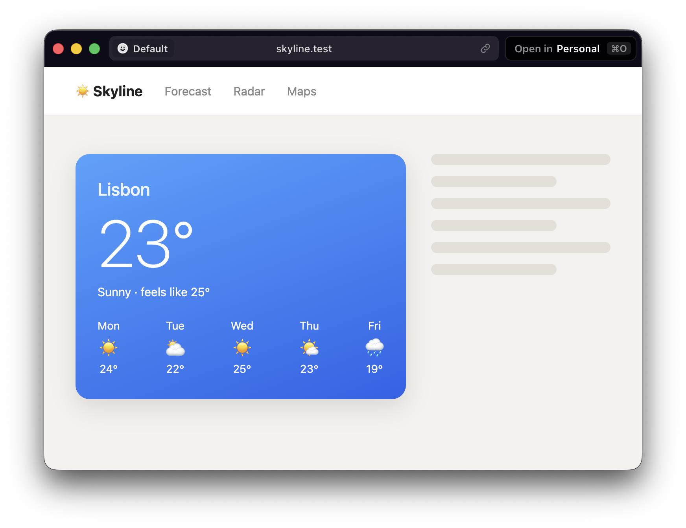

<h1 align="center">YARC: an open-source Arc browser alternative</h1>

<b>A free, open-source, Chromium-based browser for people who loved Arc.</b> 
Arc shuts down on 22 December 2026. YARC keeps its vertical-tab sidebar, Spaces, the command bar and split view, runs your Chrome extensions, and brings your Arc tabs along in one step.

<a href="https://github.com/yenebeb/yarc/releases/latest"><b>Download</b></a> · <a href="https://yenebeb.nl/yarc">Website</a> · <a href="#moving-from-arc">Moving from Arc</a> 
macOS · Windows · Linux (experimental) 
An independent project, not affiliated with The Browser Company.

## Contents

[Features](#features) · [Install](#install) · [Moving from Arc](#moving-from-arc) · [Shortcuts](#keyboard-shortcuts) · [FAQ](#faq) · [Contributing](#contributing) · [Report a bug](https://github.com/yenebeb/yarc/issues/new?template=bug.yml) · [Request a feature](https://github.com/yenebeb/yarc/issues/new?template=feature.yml)

## Features

### Nothing collected

- **no telemetry**
- **no account**
- **no servers**

The only thing YARC needs is a ping to check for updates and to refresh its ad-blocking lists.

### Spaces

Each space has its own color, and its own profile with separate logins, history and extensions. Swipe on the sidebar, or press `Ctrl+1–9` (`Alt+1–9` on Windows), to switch.

### Command bar

`⌘T` opens a tab, searches, switches to an open tab or runs a command.

### Split view

Drag a tab onto the page. Up to four tabs, side by side or stacked.

### Peek

Links from pinned tabs and favorites to other sites open in a card over the page. Shift-click any link, or right-click it and choose *Open Link in Peek*, to peek it too. `Esc` closes it, `⌘O` keeps it as a tab.

### Canvases, an alternative to Arc's Easels

`⌘⇧2` captures part of a page onto a board in your sidebar; ▶ shows a capture live. Unlike Easels, canvases work on Windows and Linux too.

### Floating player

Leave a tab while its video plays and it keeps going in a small player in front of all your apps.

### Little Window

Links from other apps open in a small window. Close it, or keep the page with **Open in** *your space*.

### And

- **Pinned tabs** remember their page; `⌘W` only unloads them.
- **Live folders** fill themselves with your GitHub pull requests or any RSS feed, fetched with your own login.
- **Today tabs** archive themselves after 12 hours (or 24 hours, 7 days, 30 days, never).
- **Ads and trackers** are blocked out of the box.
- **Chrome extensions** from the Chrome Web Store, per profile, Manifest V3 ad blockers included.
- **Several windows**, all with the same sidebar.
- **History sync** between your computers, end-to-end encrypted, through Google Drive, OneDrive, Dropbox, iCloud Drive or your own server. No YARC account and no YARC server. [How it works](docs/history-sync.md).
- **Import** from Arc, Zen, Chrome, Edge and Brave.
- Find in page, a `Ctrl+Tab` switcher, the Library, light and dark themes, and *Open in Chrome* for the odd site that needs it.

## Install

Download from the **[Releases page](https://github.com/yenebeb/yarc/releases/latest)**:

| Platform | File |
| --- | --- |
| macOS 13+, Apple silicon | `YARC-<version>-arm64.dmg` |
| macOS 13+, Intel | `YARC-<version>-x64.dmg` |
| Windows 10 / 11 | `YARC-Setup-<version>-x64.exe` (`-arm64.exe` on ARM) |
| Linux (experimental) | `YARC-<version>-x86_64.AppImage` |

YARC isn't signed by Apple or Microsoft yet, so the first launch needs one extra click:

- **macOS:** drag YARC to Applications and open it once. Then go to **System Settings → Privacy & Security** and click **Open Anyway**.
- **Windows:** when SmartScreen says *"Windows protected your PC"*, click **More info → Run anyway**. No admin rights needed.
- **Linux:** `chmod +x` the AppImage and run it. On Ubuntu 24.04+ you may need to allow unprivileged user namespaces for Chromium's sandbox.

To make YARC your default browser, run *Make YARC the Default Browser* from the command bar.

<b>Updates</b>

YARC checks for a new version at startup and every hour (turn it off in **Settings → General**).

- **macOS and Windows** download updates in the background and install them when you quit. A *Restart to Update* pill in the sidebar installs one now. Updates are signed and checked before they install.
- **macOS** may ask again for camera, microphone or screen recording after an update, because the builds have no Apple Developer ID. If YARC can't write to its own folder, it downloads the new `.dmg` instead.
- **Linux** shows an *Update Available* pill; download the new AppImage yourself.

Coming from **Arc Shell**? It's the same app under a new name, and it updates like any other version.

## Moving from Arc

Import your Arc spaces, tabs and history into YARC in one step.

> **Do this before 22 December 2026.** After that Arc won't open, though its files stay on disk.

1. Install YARC.
2. Press `⌘T` and run **Import from Arc**.

Your spaces, profiles, favorites, pinned tabs, folders, Today tabs, archive and history appear in the sidebar. Moving to another computer? Copy `~/Library/Application Support/Arc` over, then pick **Use a Different Copy…** in the import.

Not imported:

- **Passwords and logins:** export your passwords from Arc (`arc://settings/passwords` → ⋮ → Export) into a password manager first.
- **Easels:** they live on Arc's servers. Export them from Arc's Library before it shuts down.
- **Boosts and Notes:** YARC doesn't have these yet.
- **Extensions:** reinstall them from the Chrome Web Store.

Arc's Little Arc is called **Little Window** in YARC.

## Keyboard shortcuts

Arc's shortcuts work. **Mod** is `⌘` on macOS and `Ctrl` on Windows. The full list is also in **Settings → Keyboard Shortcuts**, where you can change them: click one and press the new keys.

<b>All shortcuts</b>

| Action | macOS | Windows |
| --- | --- | --- |
| New tab (command bar) | `⌘T` | `Ctrl+T` |
| Edit URL | `⌘L` | `Ctrl+L` / `Alt+D` |
| Toggle sidebar | `⌘S` | `Ctrl+S` |
| Copy URL | `⌘⇧C` | `Ctrl+Shift+C` |
| Copy URL as Markdown | `⌘⇧⌥C` | `Ctrl+Shift+Alt+C` |
| New window | `⌘N` | `Ctrl+N` |
| New Little Window | `⌘⌥N` | `Ctrl+Alt+N` |
| Close tab (unload if pinned) | `⌘W` | `Ctrl+W` / `Ctrl+F4` |
| Reopen closed tab | `⌘⇧T` | `Ctrl+Shift+T` |
| Pin / unpin tab | `⌘D` | `Ctrl+D` |
| Clear unpinned (Today) tabs | `⌘⇧K` | `Ctrl+Shift+K` |
| Next / previous tab | `⌘⌥↓` / `⌘⌥↑` | `Ctrl+Alt+↓` / `Ctrl+Alt+↑` |
| Recent-tab switcher | `⌃Tab` / `⌃⇧Tab` | `Ctrl+Tab` / `Ctrl+Shift+Tab` |
| Next / previous space | `⌘⌥→` / `⌘⌥←` | `Ctrl+Alt+→` / `Ctrl+Alt+←` |
| Switch to space 1–9 | `⌃1–9` | `Alt+1–9` |
| Go to sidebar item 1–8 (9 = last) | `⌘1–9` | `Ctrl+1–9` |
| Add split view | `⌃⇧=` | `Ctrl+Shift+=` |
| Close split view | `⌃⇧-` | `Ctrl+Shift+-` |
| Find in page / next / previous | `⌘F` / `⌘G` / `⌘⇧G` | `Ctrl+F` / `F3` / `Shift+F3` |
| History | `⌘Y` | `Ctrl+Y` |
| Downloads | `⌘⌥L` | `Ctrl+J` |
| Library | `⌘⇧L` | `Ctrl+Shift+L` |
| Developer tools | `⌘⌥I` / `F12` | `Ctrl+Shift+I` / `F12` |
| Reload / hard reload | `⌘R` / `⌘⇧R` | `Ctrl+R` or `F5` / `Ctrl+Shift+R` or `Ctrl+F5` |
| Zoom in / out / reset | `⌘=` / `⌘-` / `⌘0` | `Ctrl+=` / `Ctrl+-` / `Ctrl+0` |
| Back / forward | `⌘[` / `⌘]` | `Alt+←` / `Alt+→` |
| Settings | `⌘,` | `Ctrl+,` |
| New folder | `⌘⌥⇧N` | `Ctrl+Alt+Shift+N` |
| Duplicate tab | `⌘⇧D` | `Ctrl+Shift+D` |
| Capture part of the page to a canvas | `⌘⇧2` | `Ctrl+Shift+2` |
| Open in Chrome | `⌘⌥O` | `Ctrl+Alt+O` |

In a Little Window: `Mod+O` moves the page into the main window, `Mod+Shift+O` picks the space, `Mod+W` closes it. In Peek: `Esc` or `Mod+W` closes it, `Mod+O` opens the page as a tab.

## FAQ

**What happens when Arc shuts down?**
On 22 December 2026 Arc stops opening; its files stay on disk. Import into YARC before then ([Moving from Arc](#moving-from-arc)), and export your passwords and Easels from Arc first, because YARC can't bring those along.

**Is there an Arc browser for Windows and Linux?**
YARC runs on macOS, Windows and Linux (experimental), with Arc's sidebar, Spaces and shortcuts on all three.

**How do I export my Arc tabs and spaces?**
You don't need to: YARC reads them straight from Arc's own files. Install YARC, press `⌘T` (`Ctrl+T` on Windows) and run **Import from Arc**.

**Is YARC private?**
It collects nothing: no telemetry, no account, no servers. It only goes online on its own to check for updates and to refresh its ad-blocking lists.

**Can I sign in to Google?**
Yes, including company SSO. Only sites that demand *managed* Google Chrome won't work; use *Open in Chrome* for those.

**Does it sync with my Google account, or between my computers?**
Google only lets Chrome use Chrome Sync, so use *Import from Chrome* once instead. Your history can sync between your own computers, encrypted, through Google Drive, OneDrive, Dropbox, iCloud Drive or your own server: **Settings → Sync**. Spaces and pinned tabs don't sync yet.

**Why Electron?**
It's real Chromium, so sites and Chrome extensions work as in Chrome, and Chromium's security fixes reach you within days, without a one-person project maintaining a fork. Per page it uses the same memory as Chrome: with 8 pages open, Chrome used 746 MB and YARC 844 MB, the difference being YARC's sidebar, panels and ad blocker. [Why Electron, and how we measured](docs/why-electron.md).

**Do I need an ad-blocker extension?**
No, blocking is built in. If you'd rather use your own, Manifest V3 blockers like uBlock Origin Lite block too.

**Who makes YARC?**
One person, in their spare time. YARC is independent and not affiliated with The Browser Company; "Arc" is their trademark.

<b>Where does YARC keep my data?</b>

| | Windows | macOS |
| --- | --- | --- |
| App data | `%APPDATA%\YARC` | `~/Library/Application Support/YARC` |
| Sidebar, spaces, settings | `state.json` | `state.json` |
| History, per profile | `Profiles/<id>/history.sqlite` | same |
| Extensions, per profile | `Profiles/<id>/Extensions` | same |
| Extensions' blocking rules, per profile | `Profiles/<id>/Extension Rules` | same |
| Canvases (deleted ones stay in `.trash` for 30 days) | `Profiles/<id>/Canvases` | same |
| History sync: this computer's random ID, the key derived from your sync password, and the sign-in for your cloud drive or server | `Sync/device.json`, `Sync/key.json` (DPAPI-protected) | same (not encrypted, like the cookies and history) |
| Cookies, site storage, cache | `Partitions/profile-<id>` | same |
| Error log | `logs\main.log` | `~/Library/Logs/YARC/main.log` |

## Contributing

Found a bug? [Report it](https://github.com/yenebeb/yarc/issues/new?template=bug.yml). Missing something from Arc, or have an idea? [Request a feature](https://github.com/yenebeb/yarc/issues/new?template=feature.yml). Pull requests are welcome too.

To build it yourself: `pnpm install && pnpm dev`. Building, releasing and how the code fits together are in [docs/development.md](docs/development.md).

Planned: Boosts, Notes, syncing spaces and pinned tabs between your own devices, and code signing to remove the install warnings.

## License

[GPL-3.0-or-later](LICENSE). See [NOTICE](NOTICE) for the Arc trademark.
