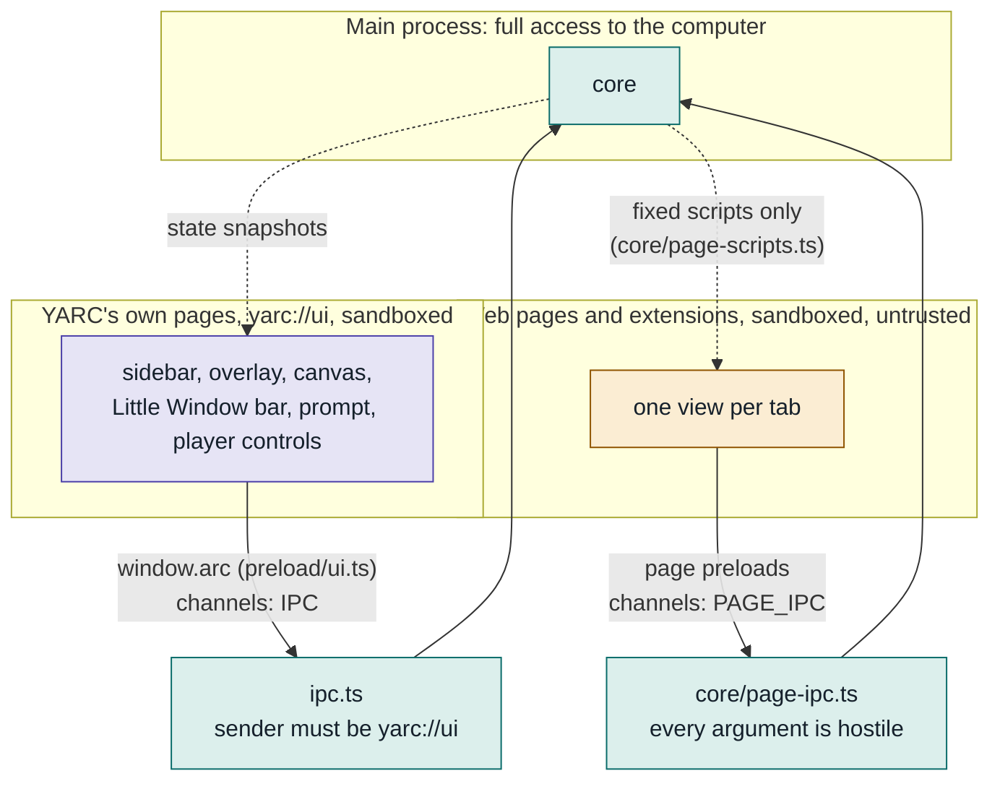
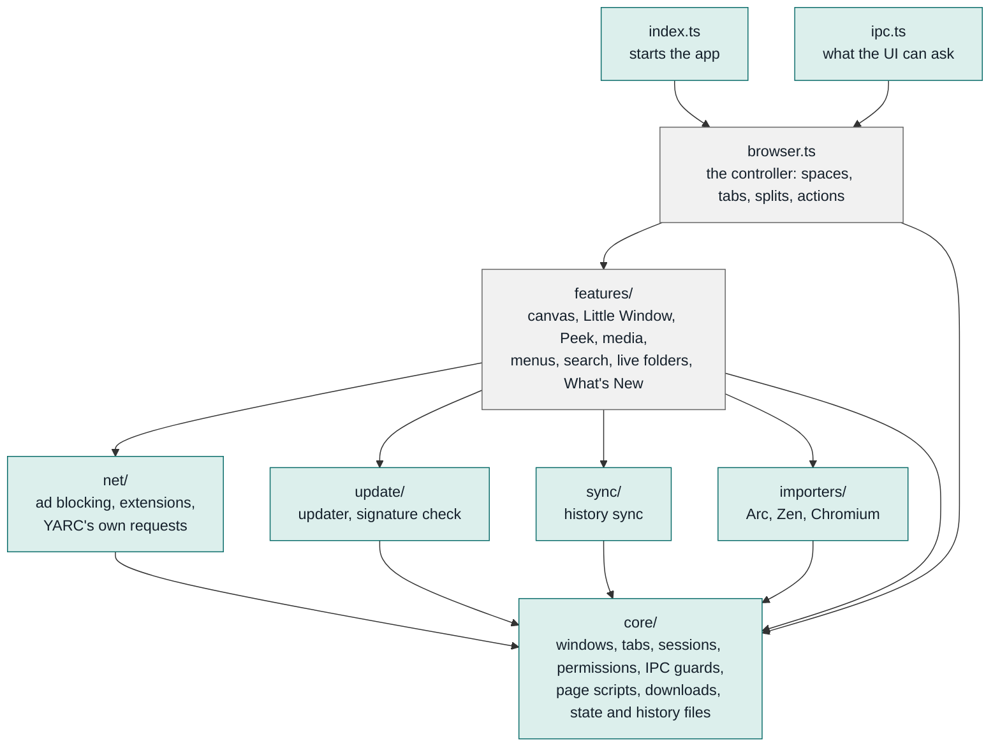

# Architecture

Where code lives, what it may touch, and what checks that. Read this before adding a file to `src/main`.

YARC updates itself on its users' computers, so the question for every change is: **does it touch something that can read a page, a cookie, the disk or the network?** The layout answers that from the path alone.

## Processes: who is trusted

| Folder | Runs in | May import |
|---|---|---|
| `src/main` | main process | `main`, `shared` |
| `src/preload` | inside a renderer, before its page | `preload`, `shared` |
| `src/renderer` | YARC's own pages | `renderer`, `shared` |
| `src/shared` | all three | `shared` only: no Electron, no Node |

The main process owns all state. Renderers get whole snapshots and send typed `Action`s back (`src/shared/actions.ts`). The two arrows into main are the attack surface, so each has one file: `src/main/ipc.ts` lists everything the UI can ask, and `PAGE_IPC` in `src/shared/ipc.ts` lists every channel a web page can send on.

## Layers inside the main process

Teal is **sensitive**: the security gate rates a change there high risk, and `CODEOWNERS` asks for the owner. Grey is where most work happens.

| Tier | Holds | Rule |
|---|---|---|
| `core/` | Everything that creates a view or window, owns a session, answers a permission, registers IPC, runs a script in a page, starts another program, or reads and writes YARC's own files | Imports only `core/` and `shared/` |
| `net/` | What filters or makes requests: ad blocking, extension APIs and their net rules, `outbound.ts` (every request a feature makes itself) | |
| `update/` | Finding, checking and installing an update | |
| `sync/` | History sync: crypto, stores, cloud drives | |
| `importers/` | Reading other browsers' profiles | |
| `features/` and `browser.ts` | What the browser does with all that | **Uses no privilege itself** |

"Uses no privilege" is literal: a file in `features/` can't name `ipcMain`, `webPreferences`, `new BrowserWindow`, `executeJavaScript`, `fetch(`, `session.fromPartition`, `.cookies`, `webRequest`, `child_process`, `shell.openExternal`, `desktopCapturer` or `.debugger`. It calls a function in a sensitive tier that does one fixed thing: `uiView('canvas')`, `selectedText(wc)`, `searchSuggestions(engine, query)`.

So a feature that needs a new privilege has to add that function, and the pull request touches a teal folder. That is the signal.

## Where to change what

| To change | Go to |
|---|---|
| What happens on a command, shortcut or UI action | `Browser.dispatch` / `runCommand` in `src/main/browser.ts`; action types in `src/shared/actions.ts` |
| A call the UI makes and waits for | `src/main/ipc.ts`, channel in `src/shared/ipc.ts`, exposed in `src/preload/ui.ts`, typed in `src/renderer/src/api.ts` |
| A message a web page sends | `PAGE_IPC` in `src/shared/ipc.ts`, handler through `core/page-ipc.ts`, sender in `src/preload/` |
| A script YARC runs in a page | `core/page-scripts.ts` (isolated worlds), `core/page-devtools.ts` (DevTools protocol) |
| A request YARC makes itself | `net/outbound.ts`; updates in `update/`, sync in `sync/` |
| A view or window of YARC's own | `uiView` / `uiWindow` in `core/ui-view.ts`; a tab's view in `core/tab.ts` |
| Sessions, permissions, downloads, cookies | `core/profiles.ts`, `core/site-permissions.ts`, `core/permission-queue.ts`, `core/download-list.ts`, `core/session-cookies.ts` |
| What is saved | `core/store.ts` (`state.json`), `core/history.ts` (SQLite), state types in `src/shared/types.ts` |
| Window layout, overlay | `core/window.ts`, `features/overlay-layout.ts`, `features/window-state.ts` |
| A feature | its file in `features/`, its panel in `src/renderer/src/panels/` |

Pure logic (layout maths, parsers, ranking) sits next to its feature without Electron imports, and has a unit test of the same name in `test/unit/`.

## What enforces it

| Check | Where | Catches |
|---|---|---|
| `test/unit/architecture.test.ts` (`pnpm test`, CI's required `check`) | this repo | Imports across processes; `core/` importing upward; a privilege used in `features/` or `browser.ts`; IPC registered outside `ipc.ts` and `core/`; a channel named as a string where it is used; a main file outside a tier; the gate's path list or `CODEOWNERS` missing a tier |
| `.github/security/semgrep.yml` (CI) | this repo | Bare `ipcMain`, weakened web preferences, code from strings, sandbox switches, cookie access |
| `security-gate.yml` | `main`'s copy only | Rates a pull request from its paths and added lines (`docs/security-review.md`) |

The test's failure message names the file, the rule and where the code belongs. Move the code; don't add an exception.

## Why this shape

- **Chromium** lets a layer depend only downward and has a security owner review every IPC definition, because the IPC contract is what hostile content can reach. Here: `core/` imports nothing above it, and both IPC surfaces are single files on the high-risk list.
- **VS Code**, also Electron, enforces its layers with an import lint. Here that is the architecture test, with no new dependency.
- **The limit:** the main process is one privilege domain. A folder can't stop code from doing anything; it makes privileged code easy to find and hard to add unnoticed. The real walls stay the process ones: sandboxed renderers, the `yarc://ui` origin check, isolated worlds.

## Adding things

- **A feature:** a file in `features/`, wired from `browser.ts`. If the test says it uses a privilege, add one narrow function to the tier named in the message.
- **A UI call:** add the channel to `IPC`, the handler to `ipc.ts` (coerce every argument: `String(url)`, `Number(offset)`), the method to `preload/ui.ts`.
- **A page message:** add the channel to `PAGE_IPC` and register with `onPage`/`handlePage`. Check `e.senderFrame` and the shape of every argument; a web page chose them.
- **A page script:** a function in `core/page-scripts.ts` with fixed code. Only numbers go into the code string, through `Number()`.
