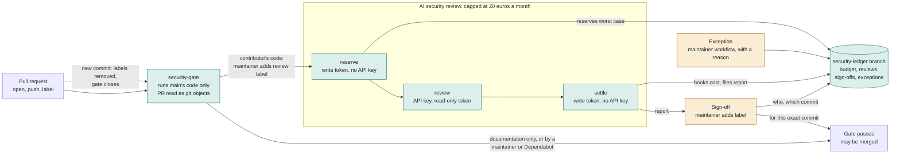
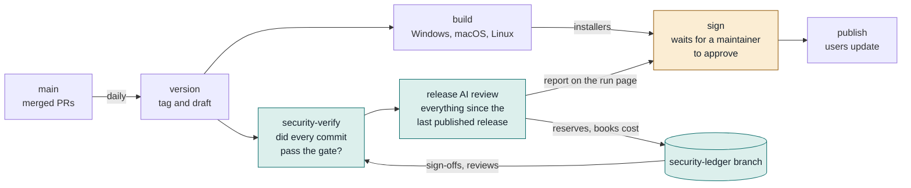

# Security review pipeline

YARC updates itself on its users' computers, so a malicious change that reaches a release reaches everyone. This pipeline automates the investigation of a change and leaves the decision to a maintainer. It never claims a change is safe.

Everything lives in `.github/security/` and the `security-*.yml` workflows. Tests: `test/unit/security-*.test.ts` (run by `pnpm test`).

## The scheme

A pull request. Teal is what this pipeline adds, amber is where a maintainer decides.

A release. If a commit did not pass the gate or the release review fails, the sign job never starts.

## How it works

1. **Every pull request gets a risk level**, decided by `classify.ts` from the changed files and added lines only (`policy.json` holds the lists). The author, the description and the AI reviewer have no say in it.
   - **Low:** only `README.md`, `docs/*.md` and screenshots, as regular files, at most 40 added lines, with no text addressed to an AI reviewer or agent.
   - **High:** a sensitive path (workflows, this pipeline, dependencies, build and release scripts, preloads, IPC, updater, sync, cookies, history, permissions, `CLAUDE.md`), or an added line that makes a network request, runs a process, builds code at runtime, hides text, touches web preferences, IPC, sessions or credentials. Also symlinks, executables and unknown binaries.
   - **Medium:** everything else.
2. **The `security-gate` status** says what the pull request still needs:

   | Author | Low | Medium | High |
   |---|---|---|---|
   | Contributor | nothing | AI review + 1 maintainer sign-off | AI review + sign-off by 2 maintainers (or by the only one there is) |
   | Maintainer, Dependabot | nothing | nothing here: covered by the release review | same |

3. **The AI review is started by a maintainer**, with the label `ready-for-security-review`. It reads the diff and the code around it through read-only tools, and posts a report in the pull request's one gate comment: confirmed findings, suspicious ones, what it could not check, and what to check by hand, each with file and line.
4. **The sign-off is the label `security-approved`**, from a maintainer, after the report exists. It is recorded for that exact commit. A new commit removes both labels and closes the gate again; it never starts a paid review.
5. **A release is not published by merging.** The daily run builds the candidate, checks that every commit since the last *published* release passed the gate, runs one AI review over all of those changes together, and then waits. A maintainer reads the report on the run's summary page and approves the `release-signing` environment. Only then are the files signed, uploaded and published.

## Day to day

**A contributor's pull request**

1. Read the gate comment: risk level and why.
2. Add `ready-for-security-review`. A few minutes later the report replaces the comment.
3. Do the "Check by hand" items. Add `security-approved`, then merge.

**The daily release**

1. Open the waiting `release` run (GitHub notifies the environment's reviewers).
2. Read the summary: the table of commits, then the release report.
3. *Review deployments* > approve. Or reject: the tag and draft stay, and the next release covers the same changes.

A run that is waiting holds the next one back, so answer it either way.

**Trying a candidate again** (a check failed for a reason that is now fixed): Actions > release > *Run workflow* on `main`. A commit whose tag was never published is picked up again.

## When something fails

The gate and the release stay closed when the AI review fails, times out, is refused, runs out of tokens or turns, returns a malformed report, when the month's budget is spent, when a reviewed commit changes, or when the risk can't be determined. The comment or the run says which.

**Exceptions** are for when a change can't wait for that. Only someone with write access can start one, the scripts only accept a maintainer from `policy.json`, and each is a commit on the `security-ledger` branch with who, when, which commit and why:

- A pull request: Actions > security-exception > *Run workflow*, with the number and a reason. It stands in for the AI review and one sign-off, for the current commit only.
- A release: Actions > release > *Run workflow*, with a reason in *security_exception*. The release still needs the environment approval.

## Cost and limits

Everything except the AI reviewer is free for a public repository. The reviewer's limits are in `policy.json`:

| Setting | Default | |
|---|---|---|
| `budget.monthlyEur` | 20 | Hard ceiling, counted in the ledger |
| `budget.releaseReservePercent` | 40 | Pull request reviews stop at 60%; release reviews can use all of it |
| `budget.maxReviewsPerPrPerDay` | 2 | |
| `budget.maxPrReviewsPerDay` | 12 | |
| `budget.maxConcurrentReviews` | 2 | |
| `reviewer.maxIterations` | 14 | Model turns per review |
| `reviewer.maxInputTokens` / `maxOutputTokens` | 400,000 / 32,000 | Per review, summed over all turns |
| `reviewer.model` | `claude-sonnet-5-5` | $2 / $10 per million tokens |

Before a review starts, its worst case (about $1.45 with the defaults) is reserved in the ledger; the push that records it only succeeds on top of the ledger that was read, so two reviews can't both take the last of the budget. Afterwards the real cost replaces the reservation. A review that never reports back keeps its full reservation. A typical review is expected to cost $0.20 to $0.40, which has not been measured against the live API yet.

A review is stored under the commit, the base it was compared with, and a hash of `policy.json` plus the reviewer prompt. The same combination is never paid for twice; a change to any of them needs a new review.

Set a monthly spend limit on the API key's workspace as well, a little above the budget. It is the second lock, not the first.

**Another model or provider:** change `reviewer.model`, `fallbackModel` and the prices. For another provider, add a client next to `anthropic.ts` that implements `CallModel` (one request in, one turn out) and return it from `modelFor`.

**A second maintainer:** add the login to `maintainers` and to `CODEOWNERS`. High-risk contributor changes then need both.

## One-time setup

In this order; until step 4 the gate only informs.

1. **Labels:** create `ready-for-security-review` and `security-approved`.
2. **Environment `security-review`:** deployment branches `main` only, no reviewers, secret `SECURITY_AI_API_KEY` (an Anthropic API key from a workspace with a monthly spend limit).
3. **Environment `release-signing`:** add yourself as required reviewer; leave *Prevent self-review* off while there is one maintainer.
4. **Ruleset `main`:** add the required status check `security-gate` (source: GitHub Actions), after seeing it pass on one Dependabot pull request and stay pending on one from a fork. Optionally `semgrep` too.
5. **New ruleset for the `security-ledger` branch:** block deletion and force pushes, so the audit trail can only grow. The first review or sign-off creates the branch.
6. **Settings > Actions > General:** *Require approval for all external contributors*; default workflow permissions read-only.
7. **Settings > Code security:** CodeQL default setup, Dependabot alerts, secret scanning with push protection, private vulnerability reporting.
8. **Install the CodeRabbit GitHub App** on this repository (free for public repositories; `.coderabbit.yaml` configures it). Its limits depend on the repository's popularity, and small repositories may need to ask for each review with a comment.
9. **The first release afterwards** contains contributor pull requests merged before the ledger existed, so its check fails. Start it by hand once with a *security_exception* reason.

## What this does and doesn't stop

| Threat | Control | What remains |
|---|---|---|
| A pull request edits the workflows, policy, prompt or `CODEOWNERS` to pass itself | The gate runs from `main` (`pull_request_target`); those paths are high risk | A maintainer who merges such a change changes the rules |
| Pull request code running with secrets | The pull request is fetched as git objects and read with `git show`, `git grep`, `git diff`. Nothing is checked out, installed or run in a privileged job | - |
| A fake `security-gate` check from a fork's own workflow | The release check ignores check runs: it recomputes every commit from the ledger and the classifier. Fork workflows need approval to run | The merge button can look green on a pull request that added such a workflow. Read the gate comment, and don't approve workflow runs for a pull request that changes `.github/` before reading that diff |
| Text in the change that instructs the AI reviewer | The prompt treats all content as evidence; untrusted text sits between random markers; a deterministic scan flags such text; the reviewer's output is validated and escaped; it has no write or network tools | The reviewer can still be fooled into a clean report. It can't open the gate: a maintainer signs off, and the risk level isn't its to set |
| Pull request spam or deliberate budget draining | Only a maintainer's label starts a paid review; per-PR and daily limits; worst case reserved first; release share kept apart | A maintainer can spend the pull request share by labelling |
| A commit pushed after the sign-off | Reviews and sign-offs are bound to the commit; the release check compares with the merged head | - |
| The API key leaking | It exists only in the `review` job, which has a read-only token; the jobs that write hold no key | The SDK and its dependencies run in that job. Loss is capped by the provider-side spend limit |
| Harmless pull requests that are dangerous together | The release review reads all changes since the last published release as one diff | An AI review of a large diff is shallow. It can't see inside updated packages |
| A compromised dependency | 1-day cooldown, `--ignore-scripts` in the review job, dependency review on pull requests, lockfile changes are high risk, release approval | A malicious package that survives a day and isn't visible in the lockfile diff still ships once approved. The release build also runs dependency code next to the macOS signing certificate; the Ed25519 update key is not exposed to it |
| A maintainer account taken over | Signed commits; ledger history | One maintainer is one point of failure, for merging and for approving releases. A second maintainer is the fix |

## Other checks

- **CodeQL** (default setup, in settings): general static analysis of TypeScript and of the workflows. Default setup so a pull request can't edit it.
- **Semgrep** (`ci.yml`, rules in `.github/security/semgrep.yml`): YARC's own invariants only: IPC through `handleUi`/`onUi`, no weakened web preferences or Chromium switches, no code built from strings, no accepted certificate errors, cookies only in session code.
- **Dependency review** (`ci.yml`): fails a pull request that adds a dependency with a known high-severity vulnerability.
- **OpenSSF Scorecard** (`scorecard.yml`): weekly, results under Security > Code scanning.
- **Build provenance:** each release file gets an attestation and the release lists `SHA256SUMS.txt`. Check one with `gh attestation verify <file> -R yenebeb/yarc`.
